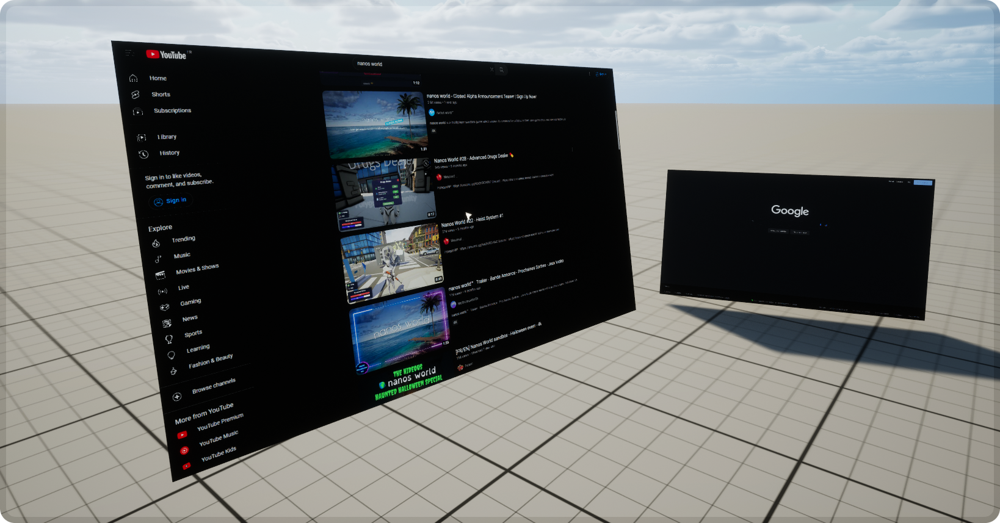

# 🖥️ WebUI3d2d

### WebUI3d2d is a library to spawn dynamic and usable WebUIs in the 3D world on nanos world!

## 📘 Docs
[Click here to access the documentation](https://github.com/Timmy-the-nobody/WebUI3d2d/blob/main/.api/docs.md)

Upgrading from 2.x? See the [migration guide](https://github.com/Timmy-the-nobody/WebUI3d2d/blob/main/.api/migrating_to_3.0.md)

## 🐛 Bug report/Feature request
[If you find a bug or have a feature request you can add it here](https://github.com/Timmy-the-nobody/WebUI3d2d/issues/new/choose)

## 💡 Pull Requests
Your PRs are welcome!
  However, in order to keep a clean code base, please follow the [coding conventions](https://github.com/Timmy-the-nobody/WebUI3d2d/blob/main/.api/coding_conventions.md) that are applied in this resource

## 📑 Features

#### 🔍 Targeting
  - 🖱️ Cursor targeting  
    - With `WebUI3d2dTargeting.Cursor` (and the mouse enabled), the cursor location is translated into a local mouse position on the UI
  - 🎥 Camera targeting
    - With `WebUI3d2dTargeting.Camera` (and the mouse disabled), the camera location and direction are used to emulate a cursor in the 3d space
  - A 3D cursor is laid on the UI mesh at the trace hit location for easier navigation, with either control (on by default, see `SetCursorDecalEnabled`)

#### 🖱️ Mouse input support
  - Mouse move events are sent to the UI
  - LMB/RMB/MMB press and release events are sent to the UI
  - Support simple and multiple (double and triple) clicks
  - Prevent inputs sent to the UI from firing key events not related to a targeted `WebUI3d2d` (see `SetBlockedGameInput`)

#### 🔠 Key input support
  - Keys go to the UI from a click on it until it's untargeted or Escape is pressed, so looking at a `WebUI3d2d` never takes the keyboard (see `SetKeyboardCapture`)
  - Seamless input of characters in text fields
  - Many ASCII chars filtering, allowing for a seamless navigation
  - AZERTY keys support
  - Supports CTRL/Alt/Shift/... CEF key modifiers
  - Uppercase support with Caps lock and Shift modifiers (for A to Z letters)
  - Prevent inputs sent to the UI from firing key events not related to a targeted `WebUI3d2d` (see `SetBlockedGameInput`)

#### 📜 Scroll support
  - Mouse scroll wheel up/down
  - Middle mouse button drag
  - Page up/down

#### 🔊 Attached 3D sound
  - The UI's audio can play in the 3d space: spawn it with WebUI's own `SpawnSound` and attach it to the mesh (see the docs' examples)

#### 🧱 Allows to override the StaticMesh plane used as `WebUI3d2d` parent
  - For instance, you can create a curved UI depending on the mesh you use
  - Optionnaly, you can change the material index used for texture projection on the mesh
  - The mesh is given at construction, and can change later in place with `SetMesh`
  - The default plane is sized from the page resolution so the page isn't stretched; `SetPlaneSize` sets it in centimetres
  - Automatic interaction range: a WebUI3d2d takes input once it fills enough of the view (a `GetScreenPercentage()` of 0.5, about a quarter of its width at a 90° FOV), whatever its scale, distance or the lens
  - On the default plane, the cursor position comes from the hit point when nanos returns no hit UV; other meshes need nanos' hit UVs
  - The 3D cursor lies on the mesh where it's hit, following a bent mesh's curve, and stays upright when the mesh faces its local +Z like SM_Plane
  - On a mesh with several material slots, a hit on another slot (a TV's frame, say) counts as a hit on the page at that slot's UV: give the page a mesh of its own for exact input

#### 🚀 Optimized target lookup
  - The "target lookup" is what handles 3D UI targetting, the cursor location on a targetted UI, and so on..
  - The maximum target lookup calls are made when an UI is already targetted (10 calls per second), otherwise there's only 4 calls per second
  - The lookup skips its trace while no `WebUI3d2d` can be targeted with the current control (cursor or camera)

#### 🧊 Automatic freezing of the CEF loop work, and the CEF painting
  - This greatly optimizes the game experience when no WebUI3d2d is targeted (or in a decent range)
  - Freeze the page when the mesh stops being rendered
  - Freeze the page when the mesh is out of range from the camera
  - `SetKeepAwake` keeps a page rendering through both, for a page used from further than the freeze range
  - `OnWebUI3d2dFreezeChange` tells scripts when a page freezes or resumes: its JavaScript keeps running while frozen, so they can pause its animations and timers
